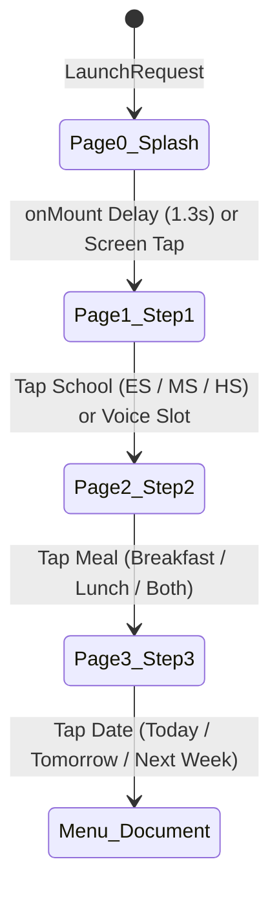

# Alexa Presentation Language (APL) Screens Architecture & Current State

This document provides a complete technical analysis of the multimodal Alexa Presentation Language (APL) screens in the **Wildcat Lunch** skill, explains what each screen is currently doing, documents the root cause of the Step 1 display defect, and specifies the new templated component architecture.

---

## 📑 Table of Contents
1. [Overview & Multimodal Strategy](#-overview--multimodal-strategy)
2. [Current Screens & Runtime Behavior](#-current-screens--runtime-behavior)
   - [Screen 1: Welcome & Guided Setup Wizard (`welcome-document.json`)](#screen-1-welcome--guided-setup-wizard)
     - [Page 0: Splash & district Brand Launcher](#page-0-splash--district-brand-launcher)
     - [Page 1: Step 1 • School Level Selection](#page-1-step-1--school-level-selection)
     - [Page 2: Step 2 • Meal Type Selection](#page-2-step-2--meal-type-selection)
     - [Page 3: Step 3 • Date Selection](#page-3-step-3--date-selection)
   - [Screen 2: Restaurant-Style Daily Menu & Gallery (`menu-document.json`)](#screen-2-restaurant-style-daily-menu--gallery)
     - [Page 0: High-End Course Menu](#page-0-high-end-course-menu)
     - [Page 1: Food Photo Gallery Sequence](#page-1-food-photo-gallery-sequence)
   - [Screen 3: 5-Day Weekly Forecast (`buildWeeklyAplDocument`)](#screen-3-5-day-weekly-forecast)
3. [Root Cause Analysis: Why Step 1 Options Were Missing](#-root-cause-analysis-why-step-1-options-were-missing)
4. [Responsive Design Specifications](#-responsive-design-specifications)
   - [Rectangular / Landscape Hubs (Echo Show 5, 8, 10, 15, TV)](#rectangular--landscape-hubs)
   - [Circular / Round Hubs (Echo Spot `@hubRound`)](#circular--round-hubs)
5. [Component Templating Architecture](#-component-templating-architecture)
6. [Testing in the Alexa Developer Console](#-testing-in-the-alexa-developer-console)

---

## 🌐 Overview & Multimodal Strategy

The Wildcat Lunch Alexa skill provides a **voice-first, multimodal-enhanced** experience:
- When a voice-only Echo device (e.g., Echo Dot) is used, Alexa responds with concise voice summaries synthesized by Google Gemini 2.5 Flash.
- When an Echo Show, Echo Spot, or Fire TV is detected (`supportedInterfaces['Alexa.Presentation.APL']`), the skill renders rich visual screens with real food photos, allergen information, district branding, and touch interaction.
- The user can interact with the skill either **by voice** (*"Elementary"*, *"Lunch"*, *"Today"*), **by touch** (tapping buttons or scrolling galleries), or a mix of both.

---

## 📱 Current Screens & Runtime Behavior

### Screen 1: Welcome & Guided Setup Wizard
- **Document Source:** `alexa/apl/welcome-document.json` & `vercel/src/lib/apl.ts` (`buildWelcomeAplDocument()`)
- **Datasource:** `buildWelcomeAplDatasource()` (`wizardData`)
- **Triggered When:**
  - The skill is launched with no specific query (*"Alexa, open Wildcat Lunch"*).
  - A user asks a question missing a school level (*"What's for lunch?"*).
  - A user asks for a school but misses the meal type (*"What's on the menu at Glacier Edge?"*).
- **Core Mechanism:**
  - Utilizes an APL `Pager` (`id: "wizardPager"`) with `navigation: "none"`.
  - Pages are controlled dynamically via client-side `SetPage` commands (for instant zero-latency visual transitions upon touch) and backend `ExecuteCommands` directives (for voice inputs).



#### Page 0: Splash & District Brand Launcher
- **Visuals:** Full-screen dark container (`#080C14`), centered Verona Area School District Wildcat paw logo (130×130dp), title *"Verona Area School District"*, subtitle *"Daily School Menus • Breakfast & Lunch"*, and a pill badge *"Touch anywhere to start →"*.
- **Actions:**
  - `onMount`: Automatically triggers an `Idle` delay of 1300ms followed by `SetPage(wizardPager, 1)`.
  - `TouchWrapper`: Tapping anywhere on the screen immediately transitions to Page 1.

#### Page 1: Step 1 • School Level Selection
- **Purpose:** Prompts the user to select one of the three Verona school levels:
  1. **Elementary** (Grades K-5: Sugar Creek, Stoner Prairie, Glacier Edge, Country View, VAIS, Core Knowledge (CKCS))
  2. **Middle School** (Grades 6-8: Badger Ridge Middle School, Core Knowledge (CKCS))
  3. **High School** (Grades 9-12: Verona Area High School)
- **Voice Prompt:** *"Welcome to Wildcat Lunch. Would you like the menu for Elementary, Middle, or High School?"*
- **Touch Event:** Sends an `Alexa.Presentation.APL.UserEvent` with `arguments: ["selectLevel", "ES" | "MS" | "HS"]` and executes `SetPage` to Page 2.

#### Page 2: Step 2 • Meal Type Selection
- **Purpose:** Prompts the user to select the meal category:
  1. **Breakfast** (Morning entree, fruits, juices, milk)
  2. **Lunch** (Hot main entree, sides, salad bar, milk)
  3. **Both Meals** (Complete daily breakfast + lunch breakdown)
- **Voice Prompt:** *"For [School], would you like breakfast, lunch, or both?"*
- **Touch Event:** Sends `arguments: ["selectMeal", "breakfast" | "lunch" | "both"]` and advances to Page 3.

#### Page 3: Step 3 • Date Selection
- **Purpose:** Prompts the user to choose the menu timeframe:
  1. **Today** (e.g., *"Mon, Oct 12"*)
  2. **Tomorrow** (e.g., *"Tue, Oct 13"*)
  3. **Next Week** (5-day Monday–Friday forecast)
- **Touch Event:** Sends `arguments: ["selectDate", "today" | "tomorrow" | "week"]`, which triggers the backend menu handler to fetch Health-e Pro data and render the daily menu or weekly document.

---

### Screen 2: School Daily Menu & Gallery
- **Document Source:** `alexa/apl/menu-document.json` & `vercel/src/lib/apl/menu-document.ts` (`buildMenuAplDocument()`)
- **Datasource:** `buildMenuAplDatasource()` (`menuData`)
- **Triggered When:** The user requests a menu for a specific date (*"What's for lunch today at the high school?"* or completing the 3-step wizard).
- **Core Mechanism:** A 2-page `Pager` (`id: "menuPager"`):
  - **Page 0 (School Menu View):**
    - **Header Bar:** Paw logo, school district banner, active school level badge, active date, quick school level switcher pills (Elementary, Middle, High School), and *"📷 See Photos"*.
    - **Left Hero Card:** High-resolution food photograph of today's primary entrée, food category badge, title, allergen pills (e.g., Milk, Wheat, Soy, Eggs), and button *"📷 View Full Food Photo Gallery →"*.
    - **Right Course Sequence:** Touch-scrollable list categorized into menu courses:
      - *Main Hot Entrées* (Daily featured main course + staple alternatives like Soy Butter & Jelly, Turkey Deli Wrap)
      - *Sides & Vegetables* (Baked Beans, Garden Salad, Steamed Broccoli)
      - *Fresh Fruits & Juices* (Cantaloupe Wedges, 100% Orange Juice)
      - *Milk & Beverages* (1% White Milk, Fat-Free Chocolate Milk)
    - **Bottom School Names Footer Bar:** Displays the exact school names included with the active school level (e.g., *Elementary Schools (K-5): Sugar Creek • Stoner Prairie • Glacier Edge • Country View • VAIS • Core Knowledge (CKCS)*).
  - **Page 1 (Food Photo Gallery View):**
    - Large 250dp wide horizontal gallery cards showcasing real CloudFront photographs for every single item on the menu.
    - Touch-scrollable sequence with standardized *"← Back to School Menu"* header button and *"← Tap here or say 'back' to return to School Menu"* bottom prompt.

---

### Screen 3: 5-Day Weekly Forecast
- **Document Source:** `vercel/src/lib/apl.ts` (`buildWeeklyAplDocument()`)
- **Datasource:** `buildWeeklyAplDatasource()` (`weeklyData`)
- **Triggered When:** A user asks for weekly menus (*"What's the menu next week for elementary?"*).
- **Visuals:** 5 horizontal day cards (Monday through Friday) showing day of the week, date, featured entrée name, photo, and secondary items.

---

## 🔍 Root Cause Analysis: Why Step 1 Options Were Missing

When inspecting the previous implementation of Step 1 (`welcome-document.json` line 206 and `apl.ts` line 225):

```json
{
  "type": "Container",
  "direction": "row",
  "width": "100%",
  "height": "calc(100% - 90dp)",
  "gap": "16dp",
  "items": [
    {
      "type": "TouchWrapper",
      "grow": 1,
      "height": "100%",
      "onPress": [ ... ]
...
```

### The Three Critical Defects:

1. **Unsupported CSS `calc()` in APL:**
   - In web browsers, `calc(100% - 90dp)` computes dynamic dimensions.
   - **APL does NOT support CSS `calc()`**. Dimension values in APL must be either absolute (e.g., `"90dp"`) or relative percentage (e.g., `"100%"`), or computed via APL data-binding expressions `${...}`.
   - When the Alexa APL runtime encounters `"height": "calc(100% - 90dp)"`, it fails to parse the string and drops the height or evaluates it to `0dp`.
   - Because the child cards had `height: "100%"`, 100% of 0 is 0. **The entire row container collapsed to 0 height**, rendering the 3 school level boxes completely invisible!

2. **Unsupported CSS `gap` property:**
   - In APL flex Containers, the CSS `gap` property is **not supported**.
   - Spacing in APL Containers must be configured using `spacing` on child items (e.g., `"spacing": "16dp"` on subsequent items) or explicit margins.

3. **Lack of Circular Hub (`@hubRound` / Echo Spot) Responsive Layout:**
   - A rigid 3-column horizontal row with long text cannot fit on a circular 480×480 Echo Spot display.
   - The text overflowed and the corners were masked out by the circular bezel.
   - No conditionality was present to switch to a vertical touch list on round screens.

---

## 📐 Responsive Design Specifications

### Rectangular / Landscape Hubs
- **Target Devices:** Echo Show 5 (960×480), Echo Show 8 (1280×800), Echo Show 10 (1280×800), Echo Show 15 (1920×1080), Fire TV (1920×1080).
- **Layout:**
  - Top: Header bar with district logo and `"STEP 1 OF 3 • SELECT SCHOOL"` badge (`height: "48dp"`, `shrink: 0`).
  - Middle: `Container` with `grow: 1`, `shrink: 1`, `direction: "row"`, `width: "100%"`.
  - Contains **3 big clickable card boxes** (Elementary, Middle School, High School):
    - Each wrapped in a full-bleed `TouchWrapper` (`grow: 1`, `shrink: 1`, `height: "100%"`).
    - Rounded corners (`borderRadius: "20dp"`), high-contrast background (`#1E293B`), subtle border (`rgba(249, 115, 22, 0.4)`).
    - Grade pill (`"GRADES K-5"`, `"GRADES 6-8"`, `"GRADES 9-12"`).
    - Large bold school level title (`26dp` font).
    - School names list with controlled `maxLines`.
    - Prominent action button pill at the bottom (`#EA580C`, `"Select Elementary →"`).
  - Bottom: Subtitle hint bar (`"💡 Or say: 'Elementary', 'Middle School', or 'High School'"`).

### Circular / Round Hubs
- **Target Devices:** Echo Spot (`@hubRound`, 480×480 circular viewport).
- **APL Condition:** `${viewport.shape == 'round' || @viewportProfile == '@hubRound'}`
- **Layout:**
  - Content centered vertically and horizontally with safe-zone insets (`padding: "24dp"`).
  - Clear, compact header: `"SELECT SCHOOL"` (`fontSize: "14dp"`, orange bold).
  - **Vertical Text List** of 3 large touchable rows:
    1. **Elementary** (Grades K-5)
    2. **Middle School** (Grades 6-8)
    3. **High School** (Grades 9-12)
  - Each item is a large touch target (`height: "64dp"`, `width: "100%"`, `borderRadius: "16dp"`, subtle border, orange arrow indicator `›`).
  - Maximum legibility and zero risk of clipping by the circular bezel.

---

## 🏗️ Component Templating Architecture

To avoid massive monolithic files (previously 2,342 lines in `apl.ts`), the code is structured into modular, single-responsibility files under `vercel/src/lib/apl/`:

```
vercel/src/lib/apl/
├── index.ts                     # Public API barrel (re-exports all build functions)
├── styles.ts                    # Shared APL style tokens (colors, fonts, textTitle, etc.)
├── components/
│   ├── header-bar.ts            # Reusable district header bar with step badge
│   └── hint-bar.ts              # Reusable footer hint bar ("💡 Or say...")
├── screens/
│   ├── splash.ts                # Page 0: Splash & Brand Launcher
│   ├── step1-school.ts          # Page 1: Step 1 School Level Selection (Round vs Landscape)
│   ├── step2-meal.ts            # Page 2: Step 2 Meal Type Selection
│   └── step3-date.ts            # Page 3: Step 3 Date Selection
├── welcome-document.ts          # Assembles the 4-page wizard APL document
├── welcome-datasource.ts        # Builds wizard payload/datasource
├── menu-document.ts             # Assembles school daily menu document
├── menu-datasource.ts           # Builds menu payload/datasource
├── weekly-document.ts           # Assembles weekly forecast document
└── weekly-datasource.ts         # Builds weekly payload/datasource
```

---

## 🧪 Testing in the Alexa Developer Console

1. Navigate to the **Alexa Developer Console** $\rightarrow$ **Multimodal** $\rightarrow$ **APL Authoring Tool**.
2. Create Document $\rightarrow$ **Start from scratch**.
3. In the **APL Document** editor, paste `alexa/apl/welcome-document.json`.
4. In the **Data** pane (bottom-left), paste `alexa/apl/sample-welcome-datasource.json`.
5. Switch device profiles using the top device dropdown:
   - **Echo Show 8 / 10 / 15**: Verify 3 large clickable card boxes fill the middle with orange action buttons.
   - **Echo Spot (Round Hub)**: Verify the screen seamlessly transforms into a clean, centered vertical text list with large touch targets.
   - **Echo Show 5**: Verify responsive scaling and touch responsiveness.
